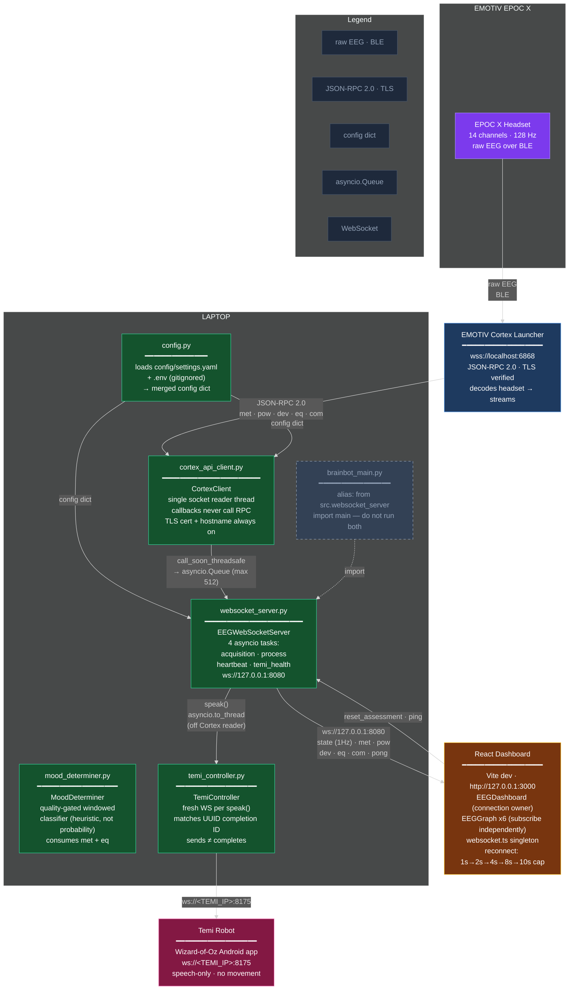

# BrainWaves — Architecture

Current system map: EMOTIV EPOC X → Cortex → Python backend → React dashboard, with optional
Temi speech. Dark theme, matching the project's original architecture diagram style.

## Notes

- **Streams subscribed**: `met` (0.1 Hz), `pow` (8 Hz), `dev` (2 Hz), `eq` (2 Hz), `com` (8 Hz mental commands).
- **`com` mental commands** are trained in EMOTIV BCI — this code only displays them in the dashboard's Push / Pull / Neutral panel (for now this is limited, we will implement once we fine-tune and train BCI profile).
- **Temi speech is opt-in**: requires both `TEMI_ENABLED=1` and `TEMI_AUTO_SPEAK=1`, then a backend restart. Speech-only, rate-limited (60 s cooldown), deduped by mood.
- **`brainbot_main.py` is an alias** — running both it and `websocket_server.py` would spawn two acquisition processes competing for the same Cortex connection.
- **TLS certificate and hostname verification stay enabled**; if Python's trust store doesn't trust EMOTIV's root, set `CORTEX_CA_FILE` to the official `rootCA.pem` rather than disabling checks.
- **Scores are heuristics, not probabilities.** No emotion-accuracy claim is established.
- **No participant data is persisted**; `reset_assessment` clears the estimator's history between participants.